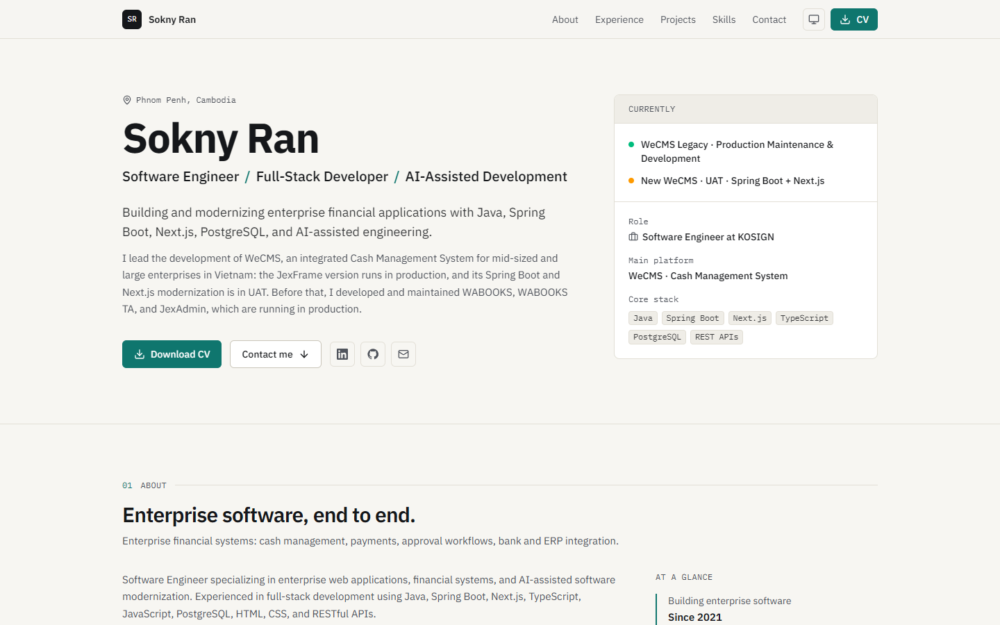

# Sokny Ran — Portfolio

Personal portfolio of **Sokny Ran**, Software Engineer | Full-Stack Developer | AI-Assisted Development.
A static, data-driven Next.js site: a single homepage. The `/projects/<slug>` case-study pages still build but are no longer linked from the site.



## Tech stack

- **Next.js 16** (App Router, static rendering, `generateStaticParams`)
- **React 19** + **TypeScript** (strict)
- **Tailwind CSS v4** with CSS-variable design tokens
- **Framer Motion** (lazy-loaded `domAnimation` features, mobile menu only)
- **Lucide** icons (GitHub/LinkedIn marks are inlined SVGs, since Lucide no longer ships brand icons)

No backend, no database, no analytics. Deploys to Vercel as-is.

## Project structure

```
app/
  layout.tsx              Root layout: fonts, metadata, theme script, navbar, footer
  page.tsx                Homepage (sections + Person JSON-LD)
  projects/[slug]/page.tsx  Case study pages (statically generated)
  not-found.tsx           404 page
  opengraph-image.tsx     Generated 1200×630 social preview image
  icon.tsx, apple-icon.tsx  Generated text-only monogram icons (no photo)
  sitemap.ts, robots.ts, manifest.ts
  globals.css             Design tokens (light/dark) + base styles
components/
  layout/                 Navbar, Footer, MotionProvider
  sections/               Hero, About, Experience, Projects, Skills, AIDevelopment, Education, Contact
  ui/                     Reusable pieces: Button, SectionHeading, ProjectCard, ExperienceItem,
                          SkillBadge, SocialLinks, ThemeToggle, Card, ArchitectureDiagram, …
data/                     ALL site content lives here
  profile.ts  social.ts  experience.ts  projects.ts  skills.ts  education.ts
lib/                      site config (URL, SEO, nav), theme helpers, active-section hook, cn()
types/                    Shared TypeScript types
public/
  resume/sokny-ran-cv.pdf The downloadable CV (edit docs/Sokny-Ran-CV.docx, then re-export)
```

Only the Navbar, ThemeToggle and MotionProvider are client components. The site uses no photos.
Everything else renders on the server at build time.

## Getting started

Requires Node.js 20.9+.

```bash
npm install
cp .env.example .env.local   # optional for local dev
npm run dev                  # http://localhost:3000
```

## Validation and build

```bash
npm run lint        # ESLint
npm run typecheck   # next typegen + tsc --noEmit
npm run build       # production build
npm run start       # serve the production build locally
```

## Updating content

All content is in `data/`. Components only render it.

| What | File | Notes |
| --- | --- | --- |
| Name, title, tagline, hero summary, about text, "At a glance" facts, languages, email | `data/profile.ts` | Remaining to-dos are listed at the top of the file |
| LinkedIn / GitHub / email links | `data/social.ts` | Used by navbar, hero, contact, footer and JSON-LD |
| Experience | `data/experience.ts` | Responsibilities are grouped; add/remove groups freely |
| Projects + case studies | `data/projects.ts` | `slug` becomes `/projects/<slug>` (unlinked); `featured: true` adds the architecture diagram to the card |
| Skills + AI workflow | `data/skills.ts` | `skillCategories` and `aiWorkflow` |
| Education | `data/education.ts` | |
| Navigation, SEO title/description/keywords | `lib/site.ts` | |

**Adding a project:** append an object to `projects` in `data/projects.ts`. The homepage card and the
(unlinked) case-study route are generated from it. Optional fields: `githubUrl`, `liveUrl`, `workflow`.

**Experience:** edit or add entries in `data/experience.ts`. An entry with `end: "Present"` gets the
highlighted timeline node.

**Skills:** edit `skillCategories` in `data/skills.ts`; they render as the Skills cards.

### Updating the CV

The editable source is `docs/Sokny-Ran-CV.docx`. After editing it, export it to PDF (in Word: File → Save As →
PDF) and overwrite `public/resume/sokny-ran-cv.pdf`. The source has no photo; keep it that way. Keep the file name, or update `resumeUrl` in
`data/profile.ts`. The download file name is `resumeFileName`.

### Social preview image

`app/opengraph-image.tsx` generates the Open Graph / Twitter image at build time from `data/profile.ts`.
To use a designed PNG instead, delete that file, add `app/opengraph-image.png` (1200×630), and update
`ogImage` in `lib/site.ts` if the path changes.

## Environment variables

See `.env.example`. Nothing secret is required.

| Variable | Purpose |
| --- | --- |
| `NEXT_PUBLIC_SITE_URL` | Optional. Public URL for canonical URLs, Open Graph, sitemap and robots. If unset, the Vercel production URL is used (`http://localhost:3000` locally). Set it once you have a custom domain. |

`.env.local` is git-ignored. Never commit it.

## Deployment

### 1. GitHub

```bash
git add .
git commit -m "Initial portfolio"
git branch -M main
git remote add origin https://github.com/<your-username>/<repo-name>.git
git push -u origin main
```

(The repository was already initialised by `create-next-app`.)

### 2. Vercel

1. Sign in at vercel.com with GitHub and choose **Add New → Project**.
2. Import the repository. Vercel detects Next.js; keep the default build settings
   (`npm run build`, output handled automatically).
3. No environment variables are required for the first deploy: the site uses the Vercel production URL
   automatically. Add `NEXT_PUBLIC_SITE_URL` later, once you connect a custom domain.
4. Deploy. Every push to `main` redeploys production; pull requests get preview URLs.

### 3. Custom domain

1. In the Vercel project: **Settings → Domains → Add**, enter your domain.
2. At your DNS provider, add the records Vercel shows (an `A` record for the apex domain and/or a
   `CNAME` to `cname.vercel-dns.com` for `www`).
3. Wait for verification; Vercel issues HTTPS automatically.
4. Update `NEXT_PUBLIC_SITE_URL` to the new domain and redeploy so canonical URLs, sitemap and social
   previews use it.

## Privacy

The site describes enterprise systems at a public level only: no customer data, internal hosts,
credentials or ticket references. Keep it that way when adding
content.
